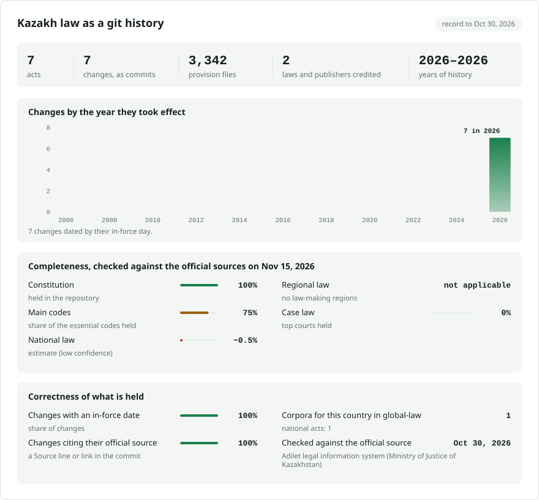

# Kazakhstan: law history in git

[Русский](README.md) · **English**

<picture>
<source media="(prefers-color-scheme: dark)" srcset="data/effort-dark.svg">

</picture>

The law of Kazakhstan as a git history: one file per article, one commit per version on the day it took effect, and the act that made each change as the commit's author (the publisher, for the oldest version available). `git blame` names the act behind every line; `git log` lists every change to an article; picking a date gives the text in force that day.

Part of [lexifina/global-law](https://github.com/lexifina/global-law), one git history for every country's law: this is Kazakhstan's national law, which global-law reads at `kazakhstan/national/acts/`.

**What is in it now:** the Constitutions of 1993, 1995 (with every edition: 1998, 2007, 2011, 2017, 2019, 2022) and 2026; the codes, in force and repealed (Civil, Criminal, Criminal Procedure, Civil Procedure, Labour, Land, Tax, Administrative Offences, Entrepreneurial and the others), each with every dated edition Adilet keeps; and constitutional laws, laws, decrees with the force of law and the normative resolutions of the Constitutional and Supreme Courts, added as they are read (about 4,400 acts listed). [`STRUCTURE.md`](STRUCTURE.md) gives the layout and the dating rules.

Folders are named in Russian, by type and year: `кодексы/2015/трудовой-кодекс/` is the Labour Code (Code of 23 November 2015 No. 414-V), `законы/<year>/<number>-<title>/` a law, `конституция/2026/` the Constitution of 2026. Each act folder has one file per article (`статья-001.md`, `статья-065-1.md`), with its section and chapter on its last lines, the text before the first article in `преамбула.md`, and a `README.md`. The first build's transliterated folders (`trudovoi-kodeks/` and six others) were removed as each act's dated history was added.

The text is in Russian, as Adilet publishes it; state organisations and local self-government bodies use Russian officially alongside Kazakh, the state language (article 9 of the Constitution). Adilet's English version is an unofficial translation and is not part of this record.

## Questions as git commands

| Question | Command |
| --- | --- |
| Every change to Article 1 of the Labour Code | `git log -p --word-diff -- кодексы/2015/трудовой-кодекс/статья-001.md` |
| Which act wrote each line of Article 1? | `git blame кодексы/2015/трудовой-кодекс/статья-001.md` |
| Every version of the Labour Code, with the day each took effect | `git log --format="%h %(trailers:key=In-force,valueonly,separator=) %an" -- кодексы/2015/трудовой-кодекс` |
| Article 1 as in force on 1 October 2020 | `git show $(git rev-list -1 --before=2020-10-02 HEAD -- кодексы/2015/трудовой-кодекс):кодексы/2015/трудовой-кодекс/статья-001.md` |

**Outside git**, we also host this record publicly, for free:

- **[Ask Claude about the law of Kazakhstan](https://global-law.lexifina.com/v1/try_claude?country=kazakhstan)**: opens Claude with a first question ready.
- **[Ask ChatGPT](https://global-law.lexifina.com/v1/try_chatgpt?country=kazakhstan)**: the same question in ChatGPT.
- **[Search Kazakhstan's law on our site](https://lexifina.com/law?country=kazakhstan&q=%D0%B5%D0%B6%D0%B5%D0%B3%D0%BE%D0%B4%D0%BD%D1%8B%D0%B9+%D1%82%D1%80%D1%83%D0%B4%D0%BE%D0%B2%D0%BE%D0%B9+%D0%BE%D1%82%D0%BF%D1%83%D1%81%D0%BA)**: a search for "ежегодный трудовой отпуск" (annual leave), with each provision's text and its versions, no account needed.
- **[Developer REST API](https://global-law.lexifina.com/v1/search_law?query=%D0%B5%D0%B6%D0%B5%D0%B3%D0%BE%D0%B4%D0%BD%D1%8B%D0%B9+%D1%82%D1%80%D1%83%D0%B4%D0%BE%D0%B2%D0%BE%D0%B9+%D0%BE%D1%82%D0%BF%D1%83%D1%81%D0%BA&jurisdiction=kazakhstan)**: the same search as JSON, with no key. See the [documentation here](https://lexifina.com/api/global-law).

Both assistants read the record through the free Global law connector (MCP, `https://global-law.lexifina.com/mcp`); the first time, the chat gives you the link that adds it. Ask in Russian or in English.

**Host it yourself easily.** All it takes is git and Python, and the tools run on your machine:

```sh
git clone --depth 1 https://github.com/lexifina/global-law && cd global-law
python3 tools/countries.py add kazakhstan/national/acts
python3 tools/law.py show 2026-11-01 kazakhstan/national/acts/кодексы/2015/трудовой-кодекс/статья-001.md
```

Opened in Claude Code, Cursor, VS Code or Codex, the clone also starts a local MCP server with the same tools ([MCP.md](https://github.com/lexifina/global-law/blob/main/MCP.md)).

## Dates

Each commit is one Adilet edition of an act, dated at noon, Asia/Almaty, on the day of that edition, and carries it in its `In-force:` trailer:

- for a later edition, the day Adilet gives the edition (its revision date);
- for the first edition, the day the text's own commencement article gives ("вводится в действие с ...", "со дня первого официального опубликования", "по истечении десяти календарных дней ..." counted from the publication day Adilet records); where that cannot be read, or falls after a later edition, the adoption day, with the stated day in `Takes-effect:`. The 2026 Constitution is dated 1 July 2026, the day its article 94 gives.

`In-force-basis:` says which rule gave each day; editions dated after the build day are held. Each later edition is credited to the latest amending act whose note first appears in it (`Amended-by:` lists them); others to the act itself. Commits before 1970 are dated 1 January 1970 with the real day in the subject and in `In-force:`.

## How it is checked

- Every commit names the Adilet edition it was read from (`Source-edition:`) and the sha256 of that edition's text (`Source-sha256:`), so any version can be compared with its source.
- Within each act, editions are committed in date order; an edition older than the one already recorded is held, not inserted. There are no merge commits.
- `tools/` and `data/` hold the first build's checks over its 7 capture-dated versions; they do not cover the Adilet editions.
- History is append-only: new acts and versions are added on top, and no published commit is rewritten.
- [vulnerabilities/](vulnerabilities/README.en.md): possible drafting mistakes in this law, found by global-law's detectors and checked by hand. Not run yet.

## What it does not show

- **Acts Adilet's search does not list**: the record holds the acts its type-by-year listing returned; some acts are missing from it.
- **Government resolutions, ministerial orders, local acts, treaties and case law** (the Supreme Court's bank of court acts is behind a CAPTCHA).
- **Adilet's notes**: the footnotes recording amendments («Сноска.») and the Institute's notes («Примечание ИЗПИ») are not in the files.
- **The Kazakh text.**

## Sources

| Source | Kind | Past versions | Notes |
| --- | --- | --- | --- |
| [Adilet](https://adilet.zan.kz) (Institute of Legislation and Legal Information, Ministry of Justice) | Official legal information system | yes, every edition | The Russian text of each edition, from the JSON the site itself reads (`/api/documents/...`), at about one request a second |

## Licence

See [`LICENSE`](LICENSE). Official documents, laws among them, are not objects of copyright in Kazakhstan (Law on Copyright and Related Rights, article 8); Adilet's terms ask that it be named as the source. Lexifina's arrangement, tables, commit messages and tools are dedicated to the public domain (CC0 1.0).

No AI model wrote, translated or corrected legal text, and none runs when the history is built; the scripts were written by Claude Code running Claude Opus 5.5 (see [`REPRODUCE.md`](REPRODUCE.md)).

## Visualisations

- [visualisations/](visualisations/README.en.md): charts drawn from this repository. Not drawn yet.

## More

From [lexifina/global-law](https://github.com/lexifina/global-law):

- [FEATURES.md](https://github.com/lexifina/global-law/blob/main/FEATURES.md): every feature, and what every corpus must support (`git blame`, `law.py`, the MCP tools)
- [FAQ.md](https://github.com/lexifina/global-law/blob/main/FAQ.md): questions and answers · [CONTRIBUTING.md](https://github.com/lexifina/global-law/blob/main/CONTRIBUTING.md): proposing changes · [MCP.md](https://github.com/lexifina/global-law/blob/main/MCP.md): the MCP server · [REPRODUCE.md](https://github.com/lexifina/global-law/blob/main/REPRODUCE.md): how it was built · [CHANGELOG.md](https://github.com/lexifina/global-law/blob/main/CHANGELOG.md)
- [FRESHNESS.md](https://github.com/lexifina/global-law/blob/main/FRESHNESS.md): how current each corpus is · [Monitoring](https://github.com/lexifina/global-law/tree/main/monitoring): whether updates are running · [WATCHING.md](https://github.com/lexifina/global-law/blob/main/WATCHING.md): how each official source is watched for changes
- [performance/](https://github.com/lexifina/global-law/tree/main/performance): how fast the tools are, measured
- [visualisations/](https://github.com/lexifina/global-law/tree/main/visualisations): charts and bridges across the world's law
- [Vulnerabilities](https://github.com/lexifina/global-law/tree/main/vulnerabilities): mistakes in legislation as published
