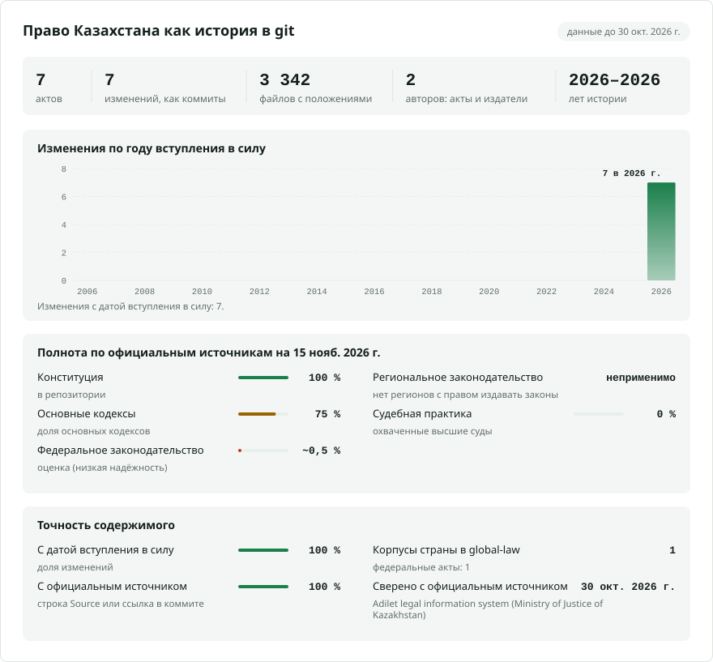

# Казахстан: история законодательства в git

**Русский** · [English](README.en.md)

<picture>
<source media="(prefers-color-scheme: dark)" srcset="data/ru/effort-dark.svg">

</picture>

Законодательство Казахстана в виде истории git: один файл на каждую статью, один коммит на каждую редакцию в день её вступления в силу, а автором коммита указан акт, внёсший изменение (для самой ранней доступной редакции — публикатор). `git blame` называет акт, стоящий за каждой строкой; `git log` перечисляет все изменения статьи; выбрав дату, можно получить текст, действовавший в тот день.

Часть [lexifina/global-law](https://github.com/lexifina/global-law) — единой истории git для законодательства всех стран: здесь национальное законодательство Казахстана, которое global-law читает по пути `kazakhstan/national/acts/`.

**Что здесь сейчас:** Конституция, принятая на республиканском референдуме 15 марта 2026 года и действующая с 1 июля 2026 года, и шесть кодексов, каждый в консолидированном тексте, опубликованном «Әділет» в период с июля по сентябрь 2026 года: Гражданский кодекс (Общая часть и Особенная часть — здесь это два акта), Уголовный кодекс, Уголовно-процессуальный кодекс, Предпринимательский кодекс и Трудовой кодекс. У каждого из этих 7 актов пока по одной редакции; редакция кодекса датирована днём, когда был сохранён её текст (см. «Даты»). [`REPRODUCE.md`](REPRODUCE.md) перечисляет их с датами; [`data/laws.csv`](data/laws.csv) перечисляет акты, названные в коммитах, со ссылками на их страницы в «Әділет».

Каждый акт — это одна папка (`trudovoi-kodeks/` — Трудовой кодекс Республики Казахстан от 23 ноября 2015 года № 414-V), в которой по одному файлу на каждую статью (`st-NNN.md`), по одному на каждый заголовок части, раздела или главы (`div-NNN.md`) и `README.md` с их перечнем. Конституция находится в `konstitutsiya/`: `preambula.md`, `razdel-NN.md` (заголовки её 11 разделов) и файлы с `st-001.md` по `st-096.md`.

Текст приводится на русском языке в том виде, в каком его публикует «Әділет»; в государственных организациях и органах местного самоуправления наравне с казахским языком, являющимся государственным, официально употребляется русский язык (статья 9 Конституции). Английская версия «Әділет» является неофициальным переводом и в эту запись не входит.

## Вопросы в виде команд git

| Вопрос | Команда |
| --- | --- |
| Все изменения статьи 1 Трудового кодекса | `git log -p --word-diff -- trudovoi-kodeks/st-001.md` |
| Какой акт написал каждую строку статьи 1? | `git blame trudovoi-kodeks/st-001.md` |
| Все редакции Трудового кодекса с днём вступления в силу каждой из них | `git log --format="%h %(trailers:key=In-force,valueonly,separator=) %an" -- trudovoi-kodeks ":(exclude)trudovoi-kodeks/README.md"` |
| Статья 1 в редакции, действовавшей на 1 октября 2026 года | `python tools/on.py 2026-10-01 trudovoi-kodeks st-001` |

**Вне git** мы также бесплатно и открыто размещаем эту запись:

- **[Спросить Claude о законодательстве Казахстана](https://global-law.lexifina.com/v1/try_claude?country=kazakhstan)**: открывает Claude с уже подготовленным первым вопросом.
- **[Спросить ChatGPT](https://global-law.lexifina.com/v1/try_chatgpt?country=kazakhstan)**: тот же вопрос в ChatGPT.
- **[Искать в законодательстве Казахстана на нашем сайте](https://lexifina.com/law?country=kazakhstan&q=%D0%B5%D0%B6%D0%B5%D0%B3%D0%BE%D0%B4%D0%BD%D1%8B%D0%B9+%D1%82%D1%80%D1%83%D0%B4%D0%BE%D0%B2%D0%BE%D0%B9+%D0%BE%D1%82%D0%BF%D1%83%D1%81%D0%BA)**: поиск по запросу «ежегодный трудовой отпуск» с текстом каждого положения и его редакциями, без учётной записи.
- **[REST API для разработчиков](https://global-law.lexifina.com/v1/search_law?query=%D0%B5%D0%B6%D0%B5%D0%B3%D0%BE%D0%B4%D0%BD%D1%8B%D0%B9+%D1%82%D1%80%D1%83%D0%B4%D0%BE%D0%B2%D0%BE%D0%B9+%D0%BE%D1%82%D0%BF%D1%83%D1%81%D0%BA&jurisdiction=kazakhstan)**: тот же поиск в формате JSON, без ключа. См. [документацию здесь](https://lexifina.com/api/global-law).

Оба ассистента читают запись через бесплатный коннектор Global law (MCP, `https://global-law.lexifina.com/mcp`); при первом обращении чат даст ссылку для его подключения. Спрашивать можно на русском или на английском.

**Легко разместить у себя.** Нужны только git и Python, а инструменты работают на вашем компьютере:

```sh
git clone --depth 1 https://github.com/lexifina/global-law && cd global-law
python3 tools/countries.py add kazakhstan/national/acts
python3 tools/law.py show 2026-11-01 kazakhstan/national/acts/trudovoi-kodeks/st-001.md
```

При открытии в Claude Code, Cursor, VS Code или Codex клон также запускает локальный MCP-сервер с теми же инструментами ([MCP.md](https://github.com/lexifina/global-law/blob/main/MCP.md)).

## Даты

Каждый коммит датирован полднем по времени Asia/Almaty дня, в который редакция вступила в силу, и содержит этот день в трейлере `In-force:`:

- для Конституции — 1 июля 2026 года, день, указанный в её статье 94; день референдума, 15 марта 2026 года, указан в трейлере `Enacted:`;
- для каждого кодекса — день снимка страницы «Әділет» в Internet Archive, из которого прочитан его текст (с 23 июля по 9 сентября 2026 года), а не день первоначального вступления кодекса в силу (например, Трудовой кодекс применяется с 1 января 2016 года).

Автором Конституции указан Республиканский референдум 15 марта 2026 года. Единственный текст каждого кодекса является «самой ранней доступной редакцией» (oldest version available), и его автором указан публикатор — информационно-правовая система «Әділет» (Министерство юстиции Республики Казахстан); в сообщении коммита назван кодекс, которым он был принят.

## Как это проверяется

- `tools/check_repo.py` считывает каждую редакцию из git на день её вступления в силу и на предшествующий день и сравнивает с корпусом, из которого она построена: 7 редакций 7 актов, расхождений нет.
- `tools/verify_part.py` сравнивает текст акта пословно с его снимком из «Әділет»; допускаются только отличия в сносках «Әділет» и другом редакционном материале, который в запись не включается. Хеш sha256 каждого снимка приведён в [`data/versions.json`](data/versions.json).
- Повторная сборка из того же корпуса дала те же хеши для каждого коммита и тега; трейлеры разбираются, коммитов слияния нет, и даты не идут назад. Результаты приведены в [`REPRODUCE.md`](REPRODUCE.md).
- История только дополняется: новые акты и редакции добавляются сверху, и ни один опубликованный коммит не переписывается.

## Чего здесь нет

- **Прежних редакций кодексов.** «Әділет» их хранит, но они не прочитаны: у каждого кодекса есть только текст 2026 года, поэтому `git blame` называет публикатора, а не изменяющий закон.
- **Конституции от 30 августа 1995 года**, которую Конституция 2026 года заменила с 1 июля 2026 года, и изменений к ней.
- **Иного законодательства**: других кодексов и законов, указов Президента, постановлений Правительства, местных актов, судебной практики и международных договоров здесь нет.
- **Примечаний «Әділет»**: сносок об изменениях («Сноска.») и примечаний Института («Примечание ИЗПИ») в файлах нет.
- **Текста на казахском языке.**

## Источники

| Источник | Вид | Прежние редакции | Примечания |
| --- | --- | --- | --- |
| [«Әділет»](https://adilet.zan.kz) (Институт законодательства и правовой информации Республики Казахстан, Министерство юстиции) | Официальная информационно-правовая система | есть, но прочитан только действующий текст | Текст каждого акта на русском языке, прочитанный со снимков его страницы в Internet Archive (27 августа 2026 года для Конституции; дата снимка каждого кодекса является датой его редакции) |

## Лицензия

См. [`LICENSE`](LICENSE). Законы в Казахстане не являются объектами авторского права (Закон «Об авторском праве и смежных правах», статья 7); подборку, таблицы, сообщения коммитов и инструменты Lexifina можно использовать повторно на условиях CC BY 4.0.

Ни одна модель ИИ не писала, не переводила и не исправляла юридический текст, и ни одна не запускается при сборке истории; скрипты написаны Claude Code на модели Claude Opus 5.5 (см. [`REPRODUCE.md`](REPRODUCE.md)).

Это перевод английской версии ([README.en.md](README.en.md)); при расхождениях действует английская версия.

## Ещё

Из репозитория [lexifina/global-law](https://github.com/lexifina/global-law) (на английском):

- [FEATURES.md](https://github.com/lexifina/global-law/blob/main/FEATURES.md): все функции и что должен поддерживать каждый корпус (`git blame`, `law.py`, инструменты MCP)
- [FAQ.md](https://github.com/lexifina/global-law/blob/main/FAQ.md): вопросы и ответы · [CONTRIBUTING.md](https://github.com/lexifina/global-law/blob/main/CONTRIBUTING.md): как предложить изменения · [MCP.md](https://github.com/lexifina/global-law/blob/main/MCP.md): MCP-сервер · [REPRODUCE.md](https://github.com/lexifina/global-law/blob/main/REPRODUCE.md): как он собран · [CHANGELOG.md](https://github.com/lexifina/global-law/blob/main/CHANGELOG.md)
- [FRESHNESS.md](https://github.com/lexifina/global-law/blob/main/FRESHNESS.md): насколько актуален каждый корпус · [Мониторинг](https://github.com/lexifina/global-law/tree/main/monitoring): работают ли обновления · [WATCHING.md](https://github.com/lexifina/global-law/blob/main/WATCHING.md): как каждый официальный источник отслеживается на изменения
- [performance/](https://github.com/lexifina/global-law/tree/main/performance): насколько быстры инструменты, по замерам
- [visualisations/](https://github.com/lexifina/global-law/tree/main/visualisations): графики и связи в праве всего мира
- [Уязвимости](https://github.com/lexifina/global-law/tree/main/vulnerabilities): ошибки в актах в опубликованном виде
